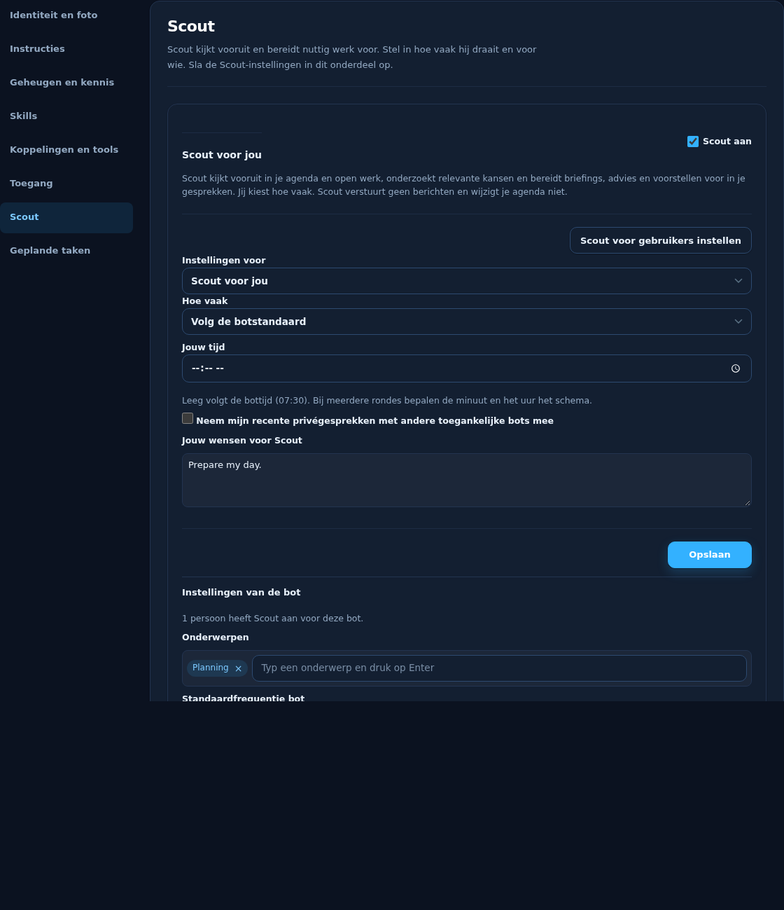
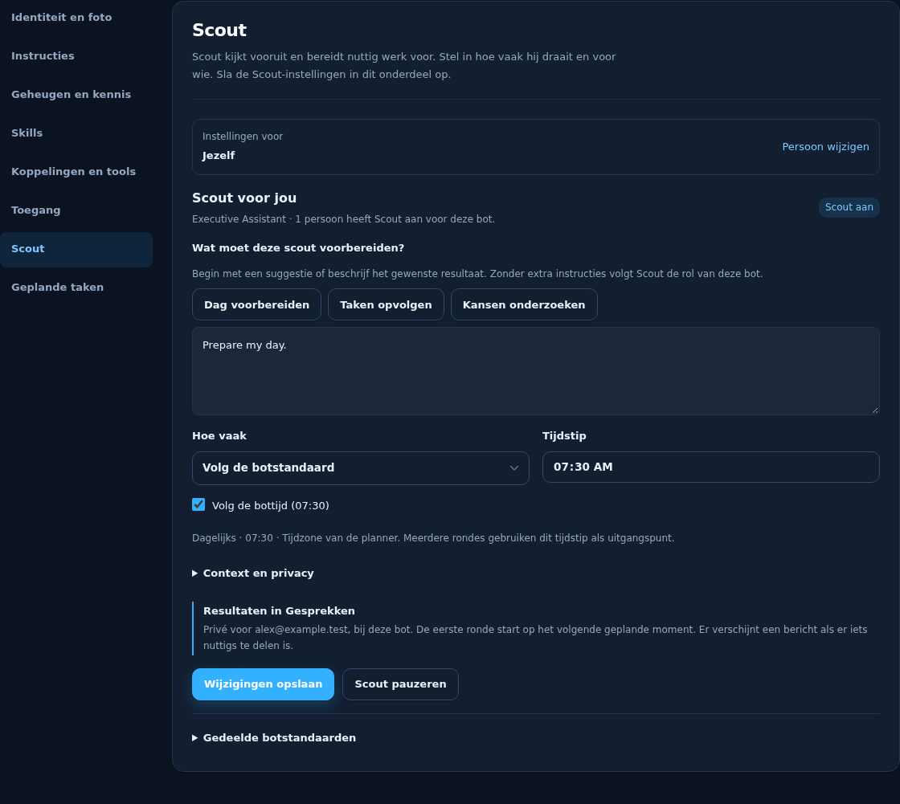
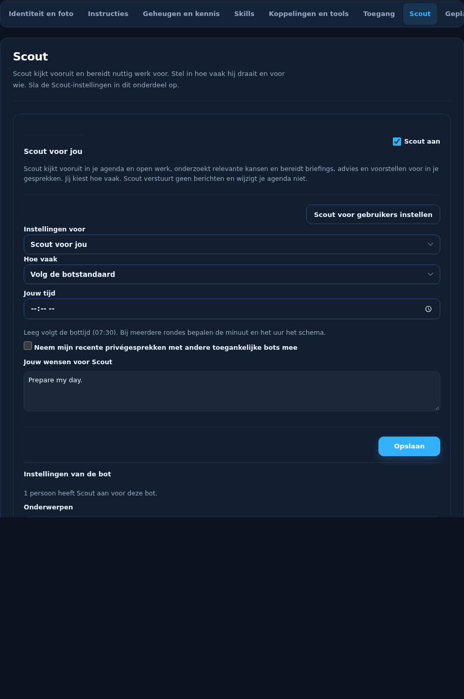
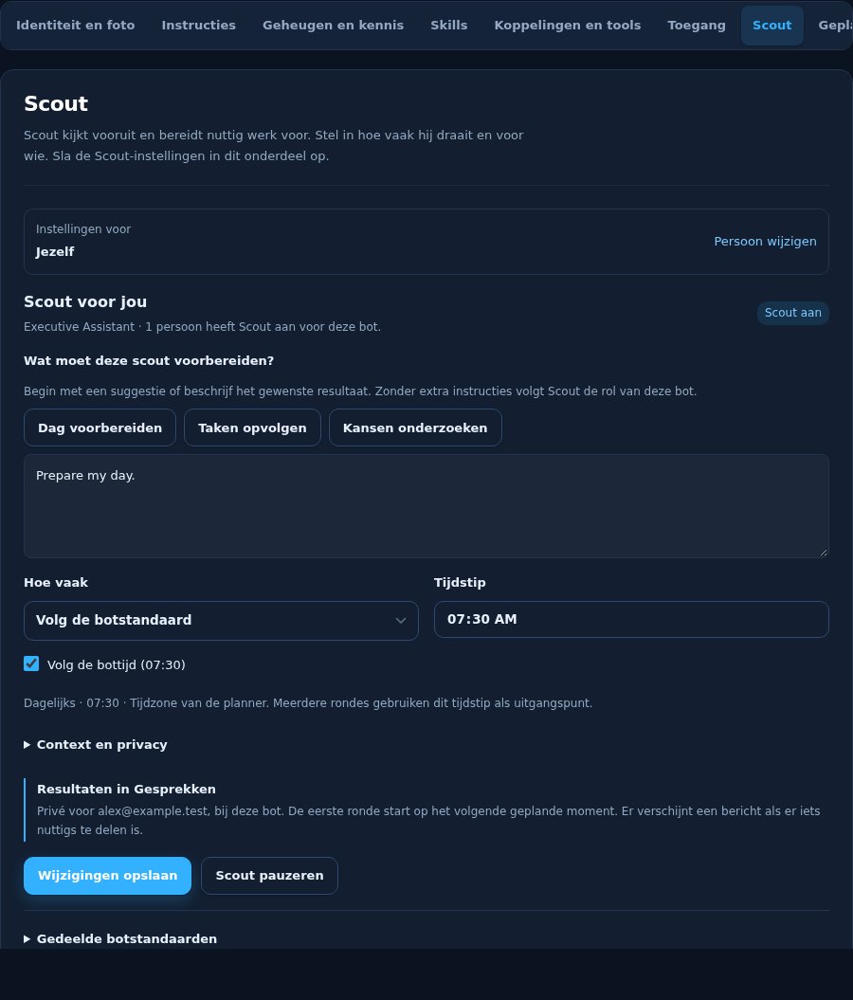
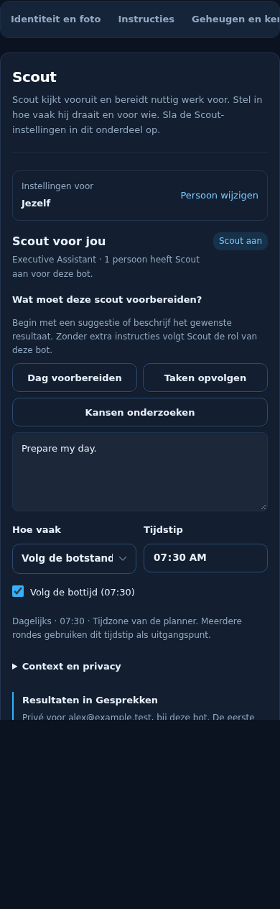

# Scout setup per person

The bot's Scout card now separates the target person, personal preparation and
schedule, and shared bot defaults. It uses the existing Scout endpoint, governance
checks and per-person job ownership. There is no new storage or scheduler.

The browser regression first failed on the old implementation: switching from
Sam to Lee and back erased Sam's unsaved instructions. It now checks separate
personal drafts, tab navigation, suggestions, local person search, inactive saves,
shared defaults, validation, failed saves, duplicate submissions, server revisions,
non-manager controls and navigation during a pending request.

Screenshots below use synthetic accounts and the real shipped styles, locale
bundles, Scout renderer and bot editor. They show the whole editor at viewport
widths 1440, 900 and 390 pixels. They are component evidence, not a claim that the
fixture executes live scheduled jobs. The existing server-side tests cover those
ownership and scheduler contracts.

| Viewport | Before | After |
| --- | --- | --- |
| Desktop |  |  |
| Laptop |  |  |
| Phone |  |  |
