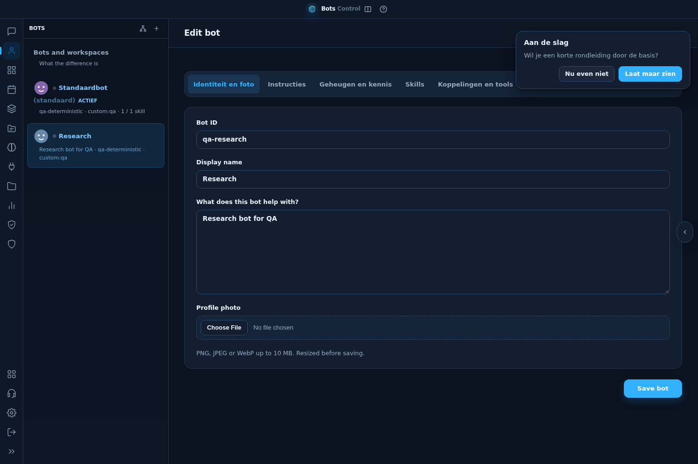
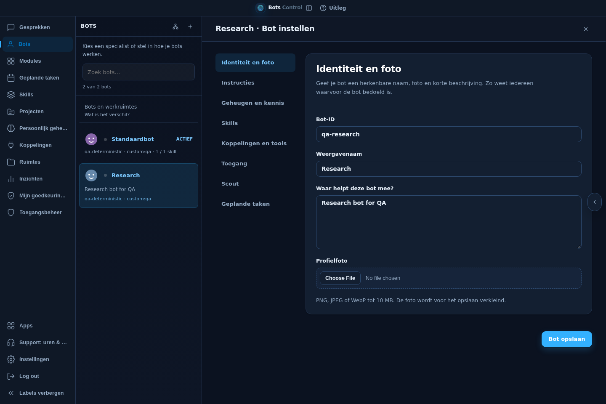
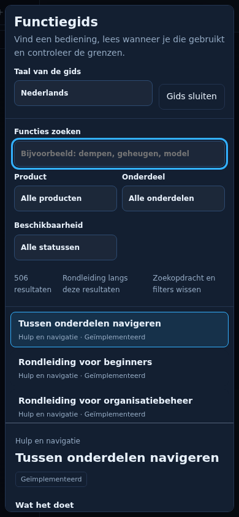
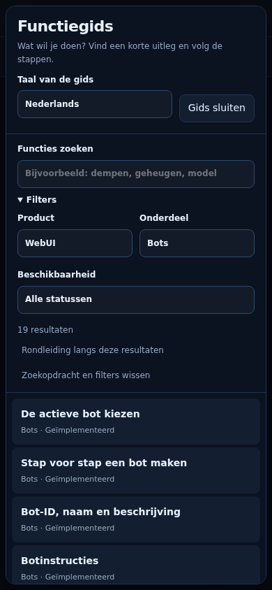

# Workspace clarity

The November 2026 review covers the main navigation, conversations, bots, tasks,
projects, skills, memory, connections, spaces, insights, approvals, governance,
apps, modules, support and settings. It preserves the existing panel owners,
permissions and save flows. Shared styling uses the existing theme tokens;
there is no new framework, runtime dependency or animation library.

## Finding and configuring bots

The bot sidebar searches the already loaded, access-filtered profile list by
display name, internal name, description and category. It reports matching and
total counts and offers a clear-search action when empty. Search temporarily
expands matching categories without changing saved category preferences. It
neither refetches jobs/profiles nor remounts the selected editor. Job badges use
the existing cache while filtering; the normal profile load refreshes them.

Cards separate the readable description from model/provider/skill metadata.
Descriptions occupy at most two lines, with their complete text available on
selection and in the title. The bot editor has a vertical section list on wide
screens and a horizontally scrollable tab list on smaller screens. The same
keyboard navigation and draft collection work in both layouts. Its section
headings explain identity, instructions, knowledge, skills, connections, access,
Scout and scheduled tasks. Creating a bot keeps the four-step review flow.

## Page rhythm and explanation

Headers, quiet empty states, touch targets and form spacing share a consistent
scale. The page-help button has a visible label. Empty bot, task, skill and space
views also offer an explanation action. Primary workflows stay in their current
panels; model, bot and workspace controls remain with the conversation.

See [the feature-guide contract](feature-guide.md) for the short page introduction
and optional complete reference. Help explains app connectors, plugins, vaults
and messaging channels separately, without naming infrastructure providers.

Unavailable connection services show a translated retry message and a suggestion
to ask the administrator if the problem persists. Cached connections remain
visible with a warning; a failed request is not presented as an empty account.
Technical backend paths are not rendered into this notice.

## Verification

Use the isolated full-app fixture for `workspace-clarity.spec.ts`,
`feature-guide.spec.ts` and `feature-interactive.spec.ts`. The behavioral checks
cover draft preservation, a network-free bot search even with an expired jobs
cache, lazy guide loading, mobile back/focus behavior and unavailable connectors.
Run the catalog, help-content, bot-builder and integration regressions through
`./scripts/test.sh` as described in `TESTING.md`.

Review screenshots at 1440, 900 and 390 pixels. Check the bot editor's sections,
the short explanation, guide results and selected topic, empty screens and
connection recovery states. The shell service worker caches the shared CSS with
the same commit-derived version as the HTML asset URL.

## Visual evidence

Synthetic fixture data only; no real accounts, chats or credentials appear.

| Screen | Before | After |
| --- | --- | --- |
| Bot editor, desktop |  |  |
| Feature guide, phone |  |  |
